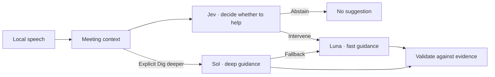

# Live Interview · Technical preview

Live Interview is a local-first macOS meeting copilot. This source preview shows how the system decides when to offer guidance, routes generation between models, and checks the result against meeting evidence.

**Jev decides whether to intervene. Luna and Sol generate the guidance.** In the desktop app, WhisperKit processes speech on the Mac. The managed service receives selected transcript and workspace text for decisions and generation. The app applies meeting-specific thresholds and checks that the context still fits before displaying a suggestion.



## Run the model routing replay

Use Node.js 24 or newer.

```bash
npm ci
npm run demo
npm run check
npm test
```

The replay runs the actual provider adapter, typed answer validator, meeting threshold and lane selection with deterministic synthetic responses. It shows Jev abstaining during routine conversation, Luna offering a follow-up when an approval gap appears, Sol handling an explicit Dig deeper, and Luna taking over after a simulated Sol outage. The fixture numbers and cards are examples. Running the replay requires no account, model key, microphone or hosted service.

[Data boundaries](docs/privacy.md) explains what stays local and what the hosted adapters receive.

## Inspect the engineering

- [Provider adapter](apps/service/src/providers.mjs) and [response validation](apps/service/src/validation.mjs) implement bounded requests, decision validation and fallback.
- [Guidance engine](packages/core/src/guidance/engine.ts), [grounding checks](packages/core/src/guidance/grounding.ts) and [evidence state](packages/core/src/snapshots.ts) assemble context, check cards and track revisions.
- [Guidance cases](eval/guidance/cases), [scoring code](packages/core/src/evaluation/guidanceScoring.ts) and the [evaluation notes](docs/evaluation.md) show the evaluation method and historical limits.

## Project history and attribution

This preview contains selected development milestones from October and November 2026, with their original author dates and attribution. The final commit contains the runnable subset. The full macOS app builds on the Parley desktop foundation and uses Argmax WhisperKit for speech. This preview contains the guidance core and managed provider adapter. See [upstream attribution](docs/attribution.md) for the broader project context.
