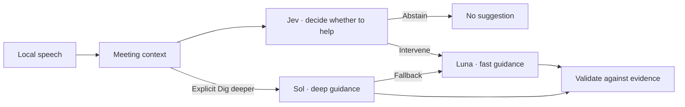

# Live Interview · Technical preview

Live Interview is a local-first macOS meeting copilot. The public source includes the desktop and local speech pipeline, the managed service, and the guidance evaluation. Two runnable previews show the meeting experience and model routing with fictional inputs.

**Jev decides whether to intervene. Luna and Sol generate the guidance.** In the desktop app, WhisperKit processes speech on the Mac. The managed service receives selected transcript and workspace text for decisions and generation. The app applies meeting-specific thresholds and checks that the context still fits before displaying a suggestion.



## Try the desktop interface in a browser

Use Node.js 24 or newer. The browser preview starts with a fictional calendar, people and workspace.

```bash
npm ci
npm run ui
```

Open the [fictional meeting workspace](http://127.0.0.1:1430/?preview=full). Choose **Set up later** to explore Calendar, Knowledge and the meeting archive. Open the [live meeting scene](http://127.0.0.1:1430/?preview=full&state=live) to see the transcript and guidance controls. This mode simulates recording, integrations, provider responses and writes.

## Run the model routing replay

Use Node.js 24 or newer.

```bash
npm ci
npm run demo
npm run check
npm test
```

The replay runs the actual provider adapter, typed answer validator, meeting threshold and lane selection with deterministic synthetic responses. It shows Jev abstaining during routine conversation, Luna offering a follow-up when an approval gap appears, Sol handling an explicit Dig deeper, and Luna taking over after a simulated Sol outage. The fixture numbers and cards are examples. Running the replay requires no account, model key, microphone or hosted service.

The [data boundaries](docs/privacy.md) page explains what stays local and what the hosted adapters receive.

## Inspect the engineering

- [Provider adapter](apps/service/src/providers.mjs) and [response validation](apps/service/src/validation.mjs) implement bounded requests, decision validation and fallback.
- [Guidance engine](packages/core/src/guidance/engine.ts), [grounding checks](packages/core/src/guidance/grounding.ts) and [evidence state](packages/core/src/snapshots.ts) assemble context, check cards and track revisions.
- [Guidance cases](eval/guidance/cases), [scoring code](packages/core/src/evaluation/guidanceScoring.ts) and the [evaluation notes](docs/evaluation.md) show the evaluation method and historical limits.

- [Desktop app and native source](apps/desktop) includes microphone and system-audio capture, the local journal and recovery, calendar and workspace context, and the meeting review.
- [Swift speech helper](native/local-speech) and the [speech benchmark](scripts/speech-benchmark/README.md) document local recognition, translation and how to measure them on a pinned dataset.

## Build the macOS candidate from source

On an Apple silicon Mac with Node.js 24+, Rust and Xcode command line tools, run `npm ci` followed by `npm run build:mac`. This builds the helper and an ad-hoc signed candidate in `artifacts/public-build/candidate`. The preview is verified through the browser and local JavaScript checks. A clean native package build, real Teams capture, and hosted provider acceptance remain separate checks.

## Project history and attribution

This preview contains selected development milestones from October and November 2026, with their original author dates and attribution. The latest source includes the desktop edition, the managed service, and both reproducible previews. The macOS app builds on the Parley desktop foundation and uses Argmax WhisperKit for speech. See [upstream attribution](docs/attribution.md) for the applicable notices.
